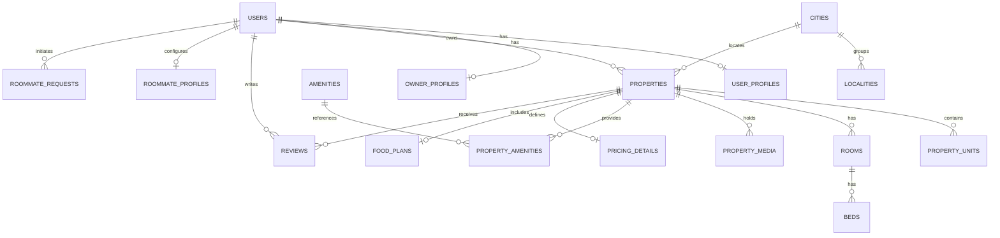

# StayConnect — Database Architecture & Schema Specification

## 1. Relational Entity Overview

The schema is built for PostgreSQL 16+ with the PostGIS extension enabled (`CREATE EXTENSION IF NOT EXISTS postgis;`).
Monetary fields use `DECIMAL(12,2)` for INR currency values. Primary keys are UUIDv4.



---

## 2. Table Specifications

### 2.1 Identity & Access
1. **`users`**
   - `id`: `UUID PRIMARY KEY DEFAULT gen_random_uuid()`
   - `email`: `VARCHAR(255) UNIQUE NULL`
   - `phone`: `VARCHAR(20) UNIQUE NOT NULL`
   - `password_hash`: `VARCHAR(255) NULL`
   - `role`: `VARCHAR(32) NOT NULL` (student, owner, manager, admin)
   - `is_phone_verified`: `BOOLEAN DEFAULT false`
   - `is_email_verified`: `BOOLEAN DEFAULT false`
   - `is_active`: `BOOLEAN DEFAULT true`
   - `last_login_at`: `TIMESTAMPTZ NULL`
   - `created_at`, `updated_at`: `TIMESTAMPTZ NOT NULL DEFAULT now()`

2. **`user_profiles`**
   - `user_id`: `UUID PRIMARY KEY REFERENCES users(id) ON DELETE CASCADE`
   - `display_name`: `VARCHAR(100) NOT NULL`
   - `avatar_url`: `TEXT NULL`
   - `gender`: `VARCHAR(20) NULL` (male, female, non_binary, prefer_not_to_say)
   - `date_of_birth`: `DATE NULL`
   - `occupation`: `VARCHAR(50) NOT NULL` (student, professional, other)
   - `college_name`: `VARCHAR(200) NULL`
   - `workplace_name`: `VARCHAR(200) NULL`
   - `city`: `VARCHAR(100) NULL`
   - `state`: `VARCHAR(100) NULL`
   - `bio`: `TEXT NULL`
   - `created_at`, `updated_at`: `TIMESTAMPTZ NOT NULL DEFAULT now()`

3. **`owner_profiles`**
   - `user_id`: `UUID PRIMARY KEY REFERENCES users(id) ON DELETE CASCADE`
   - `business_name`: `VARCHAR(150) NULL`
   - `owner_type`: `VARCHAR(32) NOT NULL` (owner, manager)
   - `id_verification_status`: `VARCHAR(32) DEFAULT 'pending'`
   - `num_properties`: `INT DEFAULT 0`
   - `avg_rating`: `DECIMAL(3,2) DEFAULT 0.00`
   - `created_at`, `updated_at`: `TIMESTAMPTZ NOT NULL DEFAULT now()`

---

### 2.2 Geography & Locations
4. **`cities`**
   - `id`: `UUID PRIMARY KEY DEFAULT gen_random_uuid()`
   - `name`: `VARCHAR(100) NOT NULL`
   - `state`: `VARCHAR(100) NOT NULL`
   - `slug`: `VARCHAR(120) UNIQUE NOT NULL`
   - `is_active`: `BOOLEAN DEFAULT true`
   - `display_order`: `INT DEFAULT 0`
   - `latitude`: `DECIMAL(9,6) NOT NULL`
   - `longitude`: `DECIMAL(9,6) NOT NULL`
   - `image_url`: `TEXT NULL`
   - `created_at`, `updated_at`: `TIMESTAMPTZ NOT NULL DEFAULT now()`

5. **`localities`**
   - `id`: `UUID PRIMARY KEY DEFAULT gen_random_uuid()`
   - `city_id`: `UUID NOT NULL REFERENCES cities(id) ON DELETE CASCADE`
   - `name`: `VARCHAR(150) NOT NULL`
   - `slug`: `VARCHAR(180) NOT NULL`
   - `pincode`: `VARCHAR(10) NOT NULL`
   - `latitude`: `DECIMAL(9,6) NULL`
   - `longitude`: `DECIMAL(9,6) NULL`
   - `location`: `GEOGRAPHY(Point, 4326) NULL`
   - `created_at`, `updated_at`: `TIMESTAMPTZ NOT NULL DEFAULT now()`

---

### 2.3 Property Catalog & Structure
6. **`properties`**
   - `id`: `UUID PRIMARY KEY DEFAULT gen_random_uuid()`
   - `owner_id`: `UUID NOT NULL REFERENCES users(id) ON DELETE RESTRICT`
   - `name`: `VARCHAR(200) NOT NULL`
   - `slug`: `VARCHAR(250) UNIQUE NOT NULL`
   - `type`: `VARCHAR(50) NOT NULL` (pg, hostel, shared_room, single_room, flat, apartment, independent_house, coliving, private_rental)
   - `description`: `TEXT NOT NULL`
   - `address_line1`: `VARCHAR(255) NOT NULL`
   - `address_line2`: `VARCHAR(255) NULL`
   - `city`: `VARCHAR(100) NOT NULL`
   - `state`: `VARCHAR(100) NOT NULL`
   - `pincode`: `VARCHAR(10) NOT NULL`
   - `locality`: `VARCHAR(150) NOT NULL`
   - `latitude`: `DECIMAL(9,6) NOT NULL`
   - `longitude`: `DECIMAL(9,6) NOT NULL`
   - `location`: `GEOGRAPHY(Point, 4326) NOT NULL`
   - `gender_preference`: `VARCHAR(20) NOT NULL DEFAULT 'any'` (male, female, any)
   - `furnishing_status`: `VARCHAR(30) NOT NULL DEFAULT 'furnished'`
   - `is_verified`: `BOOLEAN DEFAULT false`
   - `verification_level`: `SMALLINT DEFAULT 1`
   - `is_active`: `BOOLEAN DEFAULT true`
   - `is_occupied`: `BOOLEAN DEFAULT false`
   - `is_paused`: `BOOLEAN DEFAULT false`
   - `total_beds`: `INT DEFAULT 0`
   - `available_beds`: `INT DEFAULT 0`
   - `created_at`, `updated_at`: `TIMESTAMPTZ NOT NULL DEFAULT now()`

7. **`property_units`**
   - `id`: `UUID PRIMARY KEY DEFAULT gen_random_uuid()`
   - `property_id`: `UUID NOT NULL REFERENCES properties(id) ON DELETE CASCADE`
   - `unit_name`: `VARCHAR(100) NOT NULL` (e.g. "Flat 201", "Wing A")
   - `floor`: `INT DEFAULT 0`
   - `unit_type`: `VARCHAR(50) NULL` (e.g. "2BHK", "Single Studio")
   - `total_rooms`: `INT DEFAULT 1`
   - `created_at`, `updated_at`: `TIMESTAMPTZ NOT NULL DEFAULT now()`

8. **`rooms`**
   - `id`: `UUID PRIMARY KEY DEFAULT gen_random_uuid()`
   - `property_id`: `UUID NOT NULL REFERENCES properties(id) ON DELETE CASCADE`
   - `unit_id`: `UUID NULL REFERENCES property_units(id) ON DELETE SET NULL`
   - `room_name`: `VARCHAR(100) NOT NULL`
   - `room_type`: `VARCHAR(30) NOT NULL` (single, double, triple, dormitory)
   - `total_beds`: `INT NOT NULL DEFAULT 1`
   - `available_beds`: `INT NOT NULL DEFAULT 1`
   - `is_available`: `BOOLEAN DEFAULT true`
   - `created_at`, `updated_at`: `TIMESTAMPTZ NOT NULL DEFAULT now()`

9. **`beds`**
   - `id`: `UUID PRIMARY KEY DEFAULT gen_random_uuid()`
   - `room_id`: `UUID NOT NULL REFERENCES rooms(id) ON DELETE CASCADE`
   - `bed_identifier`: `VARCHAR(50) NOT NULL` (e.g., "Bed A", "Window Bed")
   - `is_occupied`: `BOOLEAN DEFAULT false`
   - `occupant_id`: `UUID NULL REFERENCES users(id) ON DELETE SET NULL`
   - `is_available`: `BOOLEAN DEFAULT true`
   - `monthly_rent`: `DECIMAL(12,2) NOT NULL`
   - `created_at`, `updated_at`: `TIMESTAMPTZ NOT NULL DEFAULT now()`

10. **`property_media`**
    - `id`: `UUID PRIMARY KEY DEFAULT gen_random_uuid()`
    - `property_id`: `UUID NOT NULL REFERENCES properties(id) ON DELETE CASCADE`
    - `media_type`: `VARCHAR(20) NOT NULL` (photo, video, virtual_tour)
    - `url`: `TEXT NOT NULL`
    - `thumbnail_url`: `TEXT NULL`
    - `caption`: `VARCHAR(255) NULL`
    - `display_order`: `INT DEFAULT 0`
    - `is_primary`: `BOOLEAN DEFAULT false`
    - `created_at`: `TIMESTAMPTZ DEFAULT now()`

11. **`amenities`**
    - `id`: `UUID PRIMARY KEY DEFAULT gen_random_uuid()`
    - `name`: `VARCHAR(100) NOT NULL`
    - `slug`: `VARCHAR(100) UNIQUE NOT NULL`
    - `category`: `VARCHAR(50) NOT NULL` (basic, safety, comfort, entertainment, kitchen, bathroom)
    - `icon_name`: `VARCHAR(50) NOT NULL`
    - `created_at`: `TIMESTAMPTZ DEFAULT now()`

12. **`property_amenities`**
    - `property_id`: `UUID NOT NULL REFERENCES properties(id) ON DELETE CASCADE`
    - `amenity_id`: `UUID NOT NULL REFERENCES amenities(id) ON DELETE CASCADE`
    - `is_available`: `BOOLEAN DEFAULT true`
    - `notes`: `VARCHAR(200) NULL`
    - `PRIMARY KEY (property_id, amenity_id)`

---

### 2.4 Pricing & Cost Transparency
13. **`pricing_details`**
    - `id`: `UUID PRIMARY KEY DEFAULT gen_random_uuid()`
    - `property_id`: `UUID UNIQUE NOT NULL REFERENCES properties(id) ON DELETE CASCADE`
    - `monthly_rent_min`: `DECIMAL(12,2) NOT NULL`
    - `monthly_rent_max`: `DECIMAL(12,2) NOT NULL`
    - `security_deposit`: `DECIMAL(12,2) NOT NULL DEFAULT 0.00`
    - `security_deposit_refundable`: `BOOLEAN NOT NULL DEFAULT true`
    - `electricity_charges_type`: `VARCHAR(30) NOT NULL DEFAULT 'metered'` (included, metered, fixed)
    - `electricity_charges_amount`: `DECIMAL(12,2) NULL`
    - `water_charges_type`: `VARCHAR(30) NOT NULL DEFAULT 'included'`
    - `water_charges_amount`: `DECIMAL(12,2) NULL`
    - `maintenance_charges`: `DECIMAL(12,2) DEFAULT 0.00`
    - `food_charges`: `DECIMAL(12,2) DEFAULT 0.00`
    - `other_charges`: `DECIMAL(12,2) DEFAULT 0.00`
    - `other_charges_description`: `TEXT NULL`
    - `is_negotiable`: `BOOLEAN DEFAULT false`
    - `created_at`, `updated_at`: `TIMESTAMPTZ NOT NULL DEFAULT now()`

14. **`food_plans`**
    - `id`: `UUID PRIMARY KEY DEFAULT gen_random_uuid()`
    - `property_id`: `UUID UNIQUE NOT NULL REFERENCES properties(id) ON DELETE CASCADE`
    - `is_food_available`: `BOOLEAN DEFAULT false`
    - `food_type`: `VARCHAR(20) NOT NULL DEFAULT 'veg'` (veg, nonveg, both)
    - `breakfast_included`: `BOOLEAN DEFAULT false`
    - `lunch_included`: `BOOLEAN DEFAULT false`
    - `dinner_included`: `BOOLEAN DEFAULT false`
    - `breakfast_timing`: `VARCHAR(50) NULL`
    - `lunch_timing`: `VARCHAR(50) NULL`
    - `dinner_timing`: `VARCHAR(50) NULL`
    - `monthly_food_charge`: `DECIMAL(12,2) DEFAULT 0.00`
    - `weekly_menu`: `JSONB NULL`
    - `food_photos`: `TEXT[] NULL`
    - `mess_rating`: `DECIMAL(3,2) DEFAULT 0.00`
    - `created_at`, `updated_at`: `TIMESTAMPTZ NOT NULL DEFAULT now()`

15. **`availability`**
    - `id`: `UUID PRIMARY KEY DEFAULT gen_random_uuid()`
    - `property_id`: `UUID NOT NULL REFERENCES properties(id) ON DELETE CASCADE`
    - `room_id`: `UUID NULL REFERENCES rooms(id) ON DELETE CASCADE`
    - `available_from`: `DATE NOT NULL`
    - `minimum_stay_months`: `INT DEFAULT 1`
    - `maximum_stay_months`: `INT NULL`
    - `instant_booking`: `BOOLEAN DEFAULT false`
    - `notice_period_days`: `INT DEFAULT 30`
    - `created_at`, `updated_at`: `TIMESTAMPTZ NOT NULL DEFAULT now()`

---

### 2.5 Roommate Finder Module
16. **`roommate_profiles`**
    - `id`: `UUID PRIMARY KEY DEFAULT gen_random_uuid()`
    - `user_id`: `UUID UNIQUE NOT NULL REFERENCES users(id) ON DELETE CASCADE`
    - `is_active`: `BOOLEAN DEFAULT true`
    - `looking_for`: `VARCHAR(50) NOT NULL` (flatmates_to_rent, roommate_for_my_flat, room_in_shared_flat)
    - `display_name`: `VARCHAR(100) NOT NULL`
    - `age`: `INT NULL`
    - `gender`: `VARCHAR(20) NULL`
    - `occupation`: `VARCHAR(50) NOT NULL`
    - `occupation_detail`: `VARCHAR(150) NULL`
    - `city`: `VARCHAR(100) NOT NULL`
    - `preferred_localities`: `TEXT[] NOT NULL DEFAULT '{}'`
    - `monthly_budget_min`: `DECIMAL(12,2) NOT NULL`
    - `monthly_budget_max`: `DECIMAL(12,2) NOT NULL`
    - `move_in_date`: `DATE NULL`
    - `preferred_flat_type`: `VARCHAR(30) DEFAULT 'any'` (1bhk, 2bhk, 3bhk, any)
    - `sharing_preference`: `VARCHAR(30) DEFAULT 'single'` (single, double, triple, any)
    - `food_preference`: `VARCHAR(20) DEFAULT 'veg'` (veg, nonveg, both)
    - `smoking_preference`: `VARCHAR(30) DEFAULT 'no_smoking'`
    - `lifestyle`: `JSONB NULL`
    - `introduction`: `TEXT NULL`
    - `profile_visibility`: `VARCHAR(30) DEFAULT 'public'` (public, connections_only, hidden)
    - `created_at`, `updated_at`: `TIMESTAMPTZ NOT NULL DEFAULT now()`

17. **`roommate_requests`**
    - `id`: `UUID PRIMARY KEY DEFAULT gen_random_uuid()`
    - `sender_id`: `UUID NOT NULL REFERENCES users(id) ON DELETE CASCADE`
    - `receiver_id`: `UUID NOT NULL REFERENCES users(id) ON DELETE CASCADE`
    - `status`: `VARCHAR(20) DEFAULT 'pending'` (pending, accepted, rejected, cancelled)
    - `message`: `TEXT NULL`
    - `created_at`, `updated_at`: `TIMESTAMPTZ NOT NULL DEFAULT now()`

18. **`roommate_connections`**
    - `id`: `UUID PRIMARY KEY DEFAULT gen_random_uuid()`
    - `user1_id`: `UUID NOT NULL REFERENCES users(id) ON DELETE CASCADE`
    - `user2_id`: `UUID NOT NULL REFERENCES users(id) ON DELETE CASCADE`
    - `connected_at`: `TIMESTAMPTZ DEFAULT now()`
    - `is_active`: `BOOLEAN DEFAULT true`
    - `created_at`: `TIMESTAMPTZ DEFAULT now()`
    - `CONSTRAINT chk_ordered_pair CHECK (user1_id < user2_id)`
    - `UNIQUE (user1_id, user2_id)`

---

### 2.6 Communication, Reviews, Trust & Audit
19. **`conversations`**
    - `id`: `UUID PRIMARY KEY DEFAULT gen_random_uuid()`
    - `type`: `VARCHAR(30) NOT NULL` (roommate, enquiry)
    - `participant1_id`: `UUID NOT NULL REFERENCES users(id) ON DELETE CASCADE`
    - `participant2_id`: `UUID NOT NULL REFERENCES users(id) ON DELETE CASCADE`
    - `property_id`: `UUID NULL REFERENCES properties(id) ON DELETE SET NULL`
    - `last_message_at`: `TIMESTAMPTZ DEFAULT now()`
    - `created_at`, `updated_at`: `TIMESTAMPTZ NOT NULL DEFAULT now()`

20. **`messages`**
    - `id`: `UUID PRIMARY KEY DEFAULT gen_random_uuid()`
    - `conversation_id`: `UUID NOT NULL REFERENCES conversations(id) ON DELETE CASCADE`
    - `sender_id`: `UUID NOT NULL REFERENCES users(id) ON DELETE CASCADE`
    - `content`: `TEXT NOT NULL`
    - `is_read`: `BOOLEAN DEFAULT false`
    - `read_at`: `TIMESTAMPTZ NULL`
    - `created_at`: `TIMESTAMPTZ DEFAULT now()`

21. **`enquiries`**
    - `id`: `UUID PRIMARY KEY DEFAULT gen_random_uuid()`
    - `property_id`: `UUID NOT NULL REFERENCES properties(id) ON DELETE CASCADE`
    - `user_id`: `UUID NOT NULL REFERENCES users(id) ON DELETE CASCADE`
    - `owner_id`: `UUID NOT NULL REFERENCES users(id) ON DELETE CASCADE`
    - `message`: `TEXT NOT NULL`
    - `enquiry_type`: `VARCHAR(30) DEFAULT 'general'`
    - `status`: `VARCHAR(20) DEFAULT 'new'`
    - `response`: `TEXT NULL`
    - `responded_at`: `TIMESTAMPTZ NULL`
    - `created_at`, `updated_at`: `TIMESTAMPTZ NOT NULL DEFAULT now()`

22. **`property_visits`**
    - `id`: `UUID PRIMARY KEY DEFAULT gen_random_uuid()`
    - `property_id`: `UUID NOT NULL REFERENCES properties(id) ON DELETE CASCADE`
    - `user_id`: `UUID NOT NULL REFERENCES users(id) ON DELETE CASCADE`
    - `owner_id`: `UUID NOT NULL REFERENCES users(id) ON DELETE CASCADE`
    - `preferred_date`: `DATE NOT NULL`
    - `preferred_time_slot`: `VARCHAR(50) NOT NULL`
    - `status`: `VARCHAR(20) DEFAULT 'requested'`
    - `owner_notes`: `TEXT NULL`
    - `user_notes`: `TEXT NULL`
    - `created_at`, `updated_at`: `TIMESTAMPTZ NOT NULL DEFAULT now()`

23. **`favourites`**
    - `id`: `UUID PRIMARY KEY DEFAULT gen_random_uuid()`
    - `user_id`: `UUID NOT NULL REFERENCES users(id) ON DELETE CASCADE`
    - `property_id`: `UUID NOT NULL REFERENCES properties(id) ON DELETE CASCADE`
    - `created_at`: `TIMESTAMPTZ DEFAULT now()`
    - `UNIQUE(user_id, property_id)`

24. **`reviews`**
    - `id`: `UUID PRIMARY KEY DEFAULT gen_random_uuid()`
    - `property_id`: `UUID NOT NULL REFERENCES properties(id) ON DELETE CASCADE`
    - `user_id`: `UUID NOT NULL REFERENCES users(id) ON DELETE CASCADE`
    - `overall_rating`: `SMALLINT NOT NULL CHECK (overall_rating BETWEEN 1 AND 5)`
    - `cleanliness_rating`: `SMALLINT NULL CHECK (cleanliness_rating BETWEEN 1 AND 5)`
    - `food_rating`: `SMALLINT NULL CHECK (food_rating BETWEEN 1 AND 5)`
    - `owner_rating`: `SMALLINT NULL CHECK (owner_rating BETWEEN 1 AND 5)`
    - `water_rating`: `SMALLINT NULL CHECK (water_rating BETWEEN 1 AND 5)`
    - `electricity_rating`: `SMALLINT NULL CHECK (electricity_rating BETWEEN 1 AND 5)`
    - `security_rating`: `SMALLINT NULL CHECK (security_rating BETWEEN 1 AND 5)`
    - `maintenance_rating`: `SMALLINT NULL CHECK (maintenance_rating BETWEEN 1 AND 5)`
    - `review_text`: `TEXT NULL`
    - `is_verified_resident`: `BOOLEAN DEFAULT false`
    - `is_approved`: `BOOLEAN DEFAULT true`
    - `reported_count`: `INT DEFAULT 0`
    - `created_at`, `updated_at`: `TIMESTAMPTZ NOT NULL DEFAULT now()`
    - `UNIQUE(property_id, user_id)`

25. **`verification_records`**
    - `id`: `UUID PRIMARY KEY DEFAULT gen_random_uuid()`
    - `property_id`: `UUID NULL REFERENCES properties(id) ON DELETE CASCADE`
    - `user_id`: `UUID NULL REFERENCES users(id) ON DELETE CASCADE`
    - `verification_type`: `VARCHAR(30) NOT NULL` (phone, identity, property_document, physical_inspection)
    - `status`: `VARCHAR(20) DEFAULT 'pending'`
    - `submitted_documents`: `JSONB NULL` (encrypted metadata & document keys)
    - `reviewer_id`: `UUID NULL REFERENCES users(id) ON DELETE SET NULL`
    - `review_notes`: `TEXT NULL`
    - `verified_at`: `TIMESTAMPTZ NULL`
    - `expires_at`: `TIMESTAMPTZ NULL`
    - `created_at`, `updated_at`: `TIMESTAMPTZ NOT NULL DEFAULT now()`

26. **`reports`**
    - `id`: `UUID PRIMARY KEY DEFAULT gen_random_uuid()`
    - `reporter_id`: `UUID NOT NULL REFERENCES users(id) ON DELETE CASCADE`
    - `reported_user_id`: `UUID NULL REFERENCES users(id) ON DELETE SET NULL`
    - `reported_property_id`: `UUID NULL REFERENCES properties(id) ON DELETE SET NULL`
    - `reported_review_id`: `UUID NULL REFERENCES reviews(id) ON DELETE SET NULL`
    - `report_type`: `VARCHAR(30) NOT NULL` (spam, inappropriate, fraud, safety, other)
    - `description`: `TEXT NOT NULL`
    - `status`: `VARCHAR(20) DEFAULT 'pending'`
    - `admin_notes`: `TEXT NULL`
    - `resolved_by`: `UUID NULL REFERENCES users(id) ON DELETE SET NULL`
    - `resolved_at`: `TIMESTAMPTZ NULL`
    - `created_at`, `updated_at`: `TIMESTAMPTZ NOT NULL DEFAULT now()`

27. **`notifications`**
    - `id`: `UUID PRIMARY KEY DEFAULT gen_random_uuid()`
    - `user_id`: `UUID NOT NULL REFERENCES users(id) ON DELETE CASCADE`
    - `type`: `VARCHAR(30) NOT NULL`
    - `title`: `VARCHAR(150) NOT NULL`
    - `body`: `TEXT NOT NULL`
    - `data`: `JSONB NULL`
    - `is_read`: `BOOLEAN DEFAULT false`
    - `read_at`: `TIMESTAMPTZ NULL`
    - `created_at`: `TIMESTAMPTZ DEFAULT now()`

28. **`audit_logs`**
    - `id`: `UUID PRIMARY KEY DEFAULT gen_random_uuid()`
    - `user_id`: `UUID NULL REFERENCES users(id) ON DELETE SET NULL`
    - `action`: `VARCHAR(100) NOT NULL`
    - `entity_type`: `VARCHAR(50) NOT NULL`
    - `entity_id`: `UUID NOT NULL`
    - `old_values`: `JSONB NULL`
    - `new_values`: `JSONB NULL`
    - `ip_address`: `VARCHAR(45) NULL`
    - `user_agent`: `TEXT NULL`
    - `created_at`: `TIMESTAMPTZ DEFAULT now()`

---

## 3. High-Performance Spatial & Index Optimization

```sql
-- Spatial GIST Index for Sub-second Radius Searches
CREATE INDEX idx_properties_spatial_location ON properties USING GIST (location);
CREATE INDEX idx_localities_spatial_location ON localities USING GIST (location);

-- Faceted Filters for Search Page
CREATE INDEX idx_properties_city_active ON properties (city, is_active, is_paused);
CREATE INDEX idx_properties_type_city ON properties (type, city);
CREATE INDEX idx_pricing_rent_range ON pricing_details (monthly_rent_min, monthly_rent_max);

-- Roommate Matching Facets
CREATE INDEX idx_roommate_city_budget ON roommate_profiles (city, monthly_budget_min, monthly_budget_max) WHERE is_active = true;
CREATE INDEX idx_roommate_looking_for ON roommate_profiles (looking_for, city) WHERE is_active = true;

-- Verification & Moderation
CREATE INDEX idx_properties_verification ON properties (is_verified, verification_level);
```
