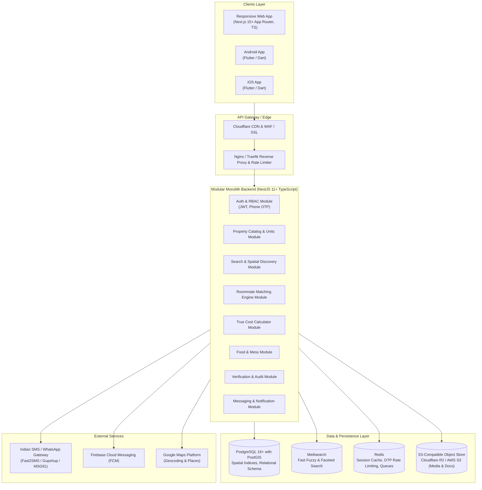

# StayConnect — Technical Architecture

## 1. System Overview

**StayConnect** is a nationwide Indian accommodation & roommate discovery platform engineered to connect property owners directly with students, young working professionals, bachelors, migrating workforce, and families looking for rental accommodation.

Core Principle: **FIND YOUR STAY. FIND YOUR PEOPLE. NO MANDATORY BROKERAGE.**

The platform covers Tier 1, Tier 2, and Tier 3 Indian cities with hyperlocal search spanning states, districts, localities, and 6-digit Indian Postal PIN codes.

---

## 2. Platform Architecture Layers

### 2.1 Web Application (Next.js 15+ App Router)
- **Framework**: Next.js 15+ (React 19, TypeScript strict mode).
- **Styling**: Tailwind CSS v4 design system, Radix UI headless primitives, Lucide React icons.
- **State Management**: Server Components for streaming & SEO metadata; Zustand for localized client state (filter bar, interactive calculator, chat sessions).
- **Form Management**: React Hook Form with Zod runtime validation.
- **Rendering Strategy**:
  - Incremental Static Regeneration (ISR) / Dynamic Server Rendering for search and property profiles.
  - Client-side rendering for authenticated dashboards (Tenant, Owner, Admin).

### 2.2 Mobile Application (Flutter Multi-platform)
- **Framework**: Flutter with Dart for unified Android & iOS native experiences.
- **State Management**: BLoC / Riverpod for predictable reactive state.
- **Networking**: Dio with interceptors for JWT auto-refresh and offline request queueing.
- **Hardware Integration**: Geolocation GPS services, camera upload for document/room photos.

### 2.3 Backend API (NestJS Modular Monolith)
- **Framework**: NestJS (Node.js LTS, TypeScript).
- **Pattern**: Modular Monolith with clear domain boundaries, dependency injection, and event emitters (`EventEmitter2`) to decouple notifications, search indexing, and audit logging.
- **Validation**: `class-validator` & `class-transformer` on incoming DTOs.
- **Security Middleware**: Helmet, CORS whitelist, ThrottlerModule for rate-limiting OTP and search requests.

---

## 3. Data & Spatial Discovery Layer

### 3.1 PostgreSQL + PostGIS
- PostGIS enables spatial queries (`ST_DWithin`, `ST_DistanceSphere`, `ST_MakePoint`).
- Coordinates stored as `GEOGRAPHY(Point, 4326)` representing standard WGS84 GPS latitude & longitude.
- Spatial index: `GIST (location)` allows sub-10ms distance calculations from colleges, tech parks, and metro stations.

### 3.2 Full-Text & Faceted Search Engine (Meilisearch)
- Indexes properties, localities, colleges, and workplaces.
- Immediate typo-tolerant search across Indian regional spellings and phonetic variations (e.g., "Koramangla" vs "Koramangala").
- Asynchronously synchronized via NestJS database subscribers.

### 3.3 Media & Document Storage
- Public bucket: Optimally compressed property photos (WebP/AVIF), room photos, food menus.
- Restricted private bucket: Owner ID proofs (Aadhaar/PAN/Electricity Bills) with signed expiring URLs (presigned GET URLs valid for 15 minutes, accessible strictly by authorized moderators).

---

## 4. Security & Compliance Architecture

1. **Authentication & Identity**:
   - Primary: Indian mobile phone verification with 6-digit cryptographic OTPs delivered via SMS/WhatsApp.
   - Secondary: Email verification for institutional/workplace verification.
   - JWT tokens: 15-minute access tokens + 30-day rotating refresh tokens stored in secure `HttpOnly`, `SameSite=Strict` cookies.
2. **Indian Digital Data Protection (DPDP) Compliance**:
   - Explicit user consent for phone numbers and location data.
   - Owner identity documents encrypted at rest using AES-256.
   - Account deletion workflows that purge PII and anonymize historical review references.
   - Strict rate limiting on OTP dispatch (max 3 OTPs per phone per 15 minutes) to protect against SMS bombing and fraud.
